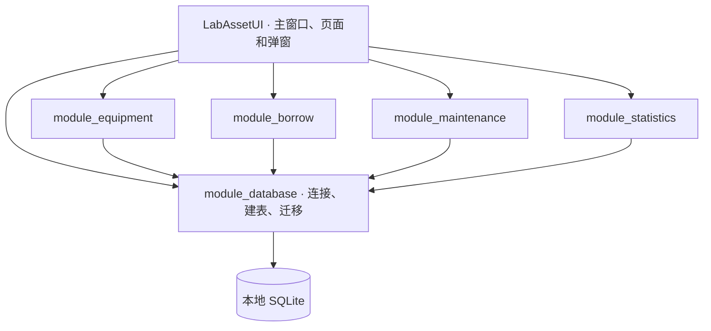

# LabAssetManage · 实验室设备资产管理系统

## 目录

1. [项目简介](#1-项目简介)
2. [系统功能](#2-系统功能)
3. [模块架构与数据设计](#3-模块架构与数据设计)
4. [团队分工与协作](#4-团队分工与协作)
5. [仓库结构与模块产物](#5-仓库结构与模块产物)
6. [构建与运行](#6-构建与运行)
7. [独立运行与发布](#7-独立运行与发布)
8. [使用示例与检查](#8-使用示例与检查)

## 1. 项目简介

LabAssetManage 是一套面向实验室设备台账的 Windows 桌面应用，使用 C++17、Qt 6 Widgets 和 SQLite 开发。系统支持设备建档与批量导入、设备借还、维修保养、设备状态统计及 CSV 导出。借还窗口支持搜索可借设备并一次借出多台，借还列表会标出仍未归还的超期记录。

设备档案是各项业务的入口。登记借出和归还后，可以在借还页查询历史记录，在设备页查看当前状态，在统计页查看各类设备的数量。遇到损坏归还时，可以在维保页接续处理，保留维修过程的记录。

[项目仓库](https://github.com/zhang512002/LabAssetManage) · [Visual Studio 总解决方案](https://github.com/zhang512002/LabAssetManage/blob/main/LabAssetManage.sln)

## 2. 系统功能

### 2.1 设备管理

- 维护资产编号、名称、型号、品牌、购置日期、价格、存放位置及责任人等信息，支持新增、编辑和删除。
- 按资产编号或设备名称查询，并按设备状态筛选。保存时检查必填项和资产编号唯一性，删除时检查设备状态和关联借还记录。
- 下载 CSV 导入模板，批量导入 `.xlsx` 或 `.csv` 设备数据。导入采用事务，任意一条写入失败时整批回滚。当前查询结果也可导出为 CSV。

设备页面和编辑弹窗负责收集表单数据，`EquipmentManager` 负责校验、查重和写入。资产编号与设备名称是导入必填项，新建和导入的设备初始为“在用”。设备档案编辑保留设备状态，由后续借还和维保操作推动状态变化。 [设备管理实现](https://github.com/zhang512002/LabAssetManage/blob/main/module_equipment/module_equipment/EquipmentManager.cpp)

### 2.2 借还登记

- 在借出窗口的「资产编号/设备名称」输入框中搜索可借设备。勾选一台或多台后，窗口显示已选台数。切换关键词时保留已勾选的设备。 [借出窗口](https://github.com/zhang512002/LabAssetManage/blob/main/LabAssetUI/pages/borrow/borrowdialog.cpp)
- 同一批设备共用借用人、借出时间、预计归还时间和备注，每台设备各生成一条记录，之后可以分别归还。提交时重新检查设备是否可借。设备状态与借还记录在同一事务中保存，其中一台写入失败时整批回滚。 [借还业务实现](https://github.com/zhang512002/LabAssetManage/blob/main/module_borrow/module_borrow/BorrowManager.cpp)
- 支持按借用人或设备名称、借出日期范围及归还状态筛选记录，并导出当前查询结果为 CSV。超过预计归还时间且仍未归还的记录，在状态列显示红色「已超期」。这类记录仍归入「未归还」筛选，可继续登记归还。 [借还页面](https://github.com/zhang512002/LabAssetManage/blob/main/LabAssetUI/pages/borrow/borrowpage.cpp)
- 归还时记录实际归还时间，设备恢复为「在用」或转为「待维修」。损坏归还提交后，主窗口通知维保页创建待维修任务。 [主窗口集成](https://github.com/zhang512002/LabAssetManage/blob/main/LabAssetUI/MainWindow.cpp)

`BorrowPage` 管理列表和操作入口，`BorrowDialog` 与 `ReturnDialog` 收集借还信息。`BorrowManager` 保留单设备借出接口，并提供接收设备 ID 列表的重载。 [借还模块公开接口](https://github.com/zhang512002/LabAssetManage/blob/main/commonlibdll/module_borrow/include/BorrowManager.h)

### 2.3 维保管理

- 登记维修与保养任务，记录关联设备、日期、费用、说明及经办人，支持按设备查询台账、编辑记录和导出当前结果。
- 待维修任务可以开始处理，进行中的维修或保养可以标记完成。任务完成时同步将设备恢复为“在用”，台账保留处理记录。
- 接收损坏归还通知，建立对应的待维修任务，并避免为同一设备重复建立进行中的任务。

`MaintenanceManager` 同时维护设备状态与任务状态。维修可以先登记为待维修，也可以直接登记为处理中。保养任务登记后进入处理中。开始与完成操作会在事务中同步对应的设备状态，已完成的任务仍可在台账查询。 [维保业务实现](https://github.com/zhang512002/LabAssetManage/blob/main/module_maintenance/module_maintenance/MaintenanceManager.cpp)

### 2.4 统计与导出

- 统计“在用、借出、待维修、维修中、保养中、已报废”六类设备状态，以卡片和明细表展示数量、占比及总计。
- 分别导出设备总览、借还记录和维保记录。业务页导出当前筛选结果，统计页按对应报表的预设字段导出记录。
- 统计查询由 `StatisticsManager` 完成，界面负责展示、选择保存位置和写入 CSV。

设备总览包含资产编号、名称、型号、状态和位置。借还报表提供借用人、设备、借出时间、归还时间和状态。维保报表提供日期、设备、类型、任务状态、费用和描述。 [报表查询实现](https://github.com/zhang512002/LabAssetManage/blob/main/module_statistics/module_statistics/StatisticsManager.cpp)

## 3. 模块架构与数据设计

### 3.1 分层与依赖



| 层级                        | 职责                                                              |
| ------------------------- | --------------------------------------------------------------- |
| 界面层 `LabAssetUI`          | 收集输入、调用业务接口、显示结果。主窗口使用 `QListWidget` 和 `QStackedWidget` 管理四个页面。 |
| 四个业务 DLL                  | 通过各自的 Manager 提供业务校验、查询、写入与状态流转。四个模块各自依赖数据库 DLL，跨页面事件由主窗口连接。    |
| 数据库 DLL `module_database` | 初始化 SQLite、创建和迁移数据表，提供公共状态定义。各模块共用名为 `lab_asset_main` 的连接；维保记录结构由维保模块维护。 |

### 3.2 数据表与关联

| 数据表                  | 主要字段                           | 关联                     |
| -------------------- | ------------------------------ | ---------------------- |
| `equipment`          | 资产编号、名称、位置、设备状态等               | `id` 为主键，`asset_no` 唯一 |
| `borrow_record`      | 借用人、借出时间、预计归还时间、实际归还时间、借还状态和备注 | `equipment_id` 关联设备    |
| `maintenance_record` | 维保日期、类型、任务状态、费用、说明和经办人         | `equipment_id` 关联设备    |

一台设备可对应多条借还记录和维保记录。首次启动时创建所需数据表，并开启 SQLite 外键约束。初始化还包含旧设备状态值的转换及维保任务状态字段的迁移。 [数据库初始化实现](https://github.com/zhang512002/LabAssetManage/blob/main/module_database/module_database/databasemanager.cpp)

### 3.3 状态流转

| 操作   | 设备状态变化       | 对应记录             |
| ---- | ------------ | ---------------- |
| 登记借出 | 在用 → 借出      | 每台设备新增一条未归还记录    |
| 正常归还 | 借出 → 在用      | 填写实际归还时间并标记为已归还  |
| 损坏归还 | 借出 → 待维修     | 完成归还登记，通知维保页创建任务 |
| 开始维修 | 待维修 → 维修中    | 任务进入处理中          |
| 登记保养 | 在用 → 保养中     | 新增处理中的保养任务       |
| 完成维保 | 维修中或保养中 → 在用 | 任务标记为已完成         |

设备状态用于设备列表、借出判断和统计。维保任务另有待处理、处理中、已完成三种状态，用于表示单条任务的进度。状态代码与界面文案由公共头文件统一定义。 [状态定义](https://github.com/zhang512002/LabAssetManage/blob/main/module_database/module_database/enums.h)

### 3.4 跨页面更新

设备、借还或维保页面发出 `dataChanged()` 后，`MainWindow` 调用四个页面的刷新接口。损坏归还另有 `damagedEquipmentReturned(equipmentId)` 信号，由主窗口连接到维保页的任务创建接口。归还登记先提交自己的事务，维保页面随后根据设备 ID 创建任务。 [主窗口集成](https://github.com/zhang512002/LabAssetManage/blob/main/LabAssetUI/MainWindow.cpp)

## 4. 团队分工与协作

| 成员  | 模块                   | 主要工作                  |
| --- | -------------------- | --------------------- |
| 温麒霖 | `module_equipment`   | 设备档案、查询筛选、批量导入及模板     |
| 张梦依 | `module_borrow`      | 可借设备搜索、批量借出、归还登记、记录查询 |
| 张泽心 | `module_maintenance` | 维修保养台账、任务开始与完成、设备状态联动 |
| 赵圆圆 | `module_statistics`  | 状态数量与占比统计、设备和业务报表导出   |

各成员按业务模块分工，集成工作围绕公共约定和模块接口展开。

1. **统一数据约定。** 四个模块使用同一套设备状态定义，通过公共数据库连接读写资产档案和关联记录。
2. **约定模块接口。** 各模块通过公共头文件提供 Manager 接口，界面把表单输入传给对应模块，并展示接口返回的结果或错误。
3. **集成界面与产物。** 各模块的头文件、导入库和运行 DLL 归集到 `commonlibdll`。总解决方案管理生成顺序，`LabAssetUI` 统一链接并装配四个页面。
4. **接通跨页业务。** 借还页登记损坏归还后，维保页接续建立任务，设备页和统计页按共享数据刷新。各页面通过主窗口协调。

## 5. 仓库结构与模块产物

### 5.1 源码目录

```text
LabAssetManage/
├── LabAssetManage.sln          # 总解决方案
├── LabAssetUI/                 # 应用入口、主窗口和页面
│   ├── pages/                  # equipment、borrow、maintenance、statistics
│   ├── shared/                 # 界面共用的 CSV 导出工具
│   └── CommonSettings.props    # 模块头文件与导入库路径
├── module_database/           # SQLite 连接、建表、迁移和公共类型
├── module_equipment/          # EquipmentManager 和导入逻辑
├── module_borrow/             # BorrowManager 和借还事务
├── module_maintenance/        # MaintenanceManager 和维保任务
├── module_statistics/         # StatisticsManager 和报表查询
└── commonlibdll/              # 各模块的公开头文件与构建产物
```

各 `module_*` 目录保留对应模块的独立解决方案，内部的同名子目录包含该模块的 `.vcxproj` 和源码。四个页面及相应弹窗集中在 `LabAssetUI/pages/`，从界面调用的接口以 `commonlibdll` 中的公开头文件为准。

### 5.2 模块交付目录

| 路径                            | 用途                     |
| ----------------------------- | ---------------------- |
| `commonlibdll/<模块名>/include/` | 保存 Manager 接口、公共类型等头文件 |
| `commonlibdll/<模块名>/lib/`     | 保存生成后的导入库，供依赖项目链接      |
| `commonlibdll/<模块名>/bin/`     | 保存生成后的 DLL，供应用运行时加载    |

修改公开接口后，更新对应的交付头文件，并重新生成模块和依赖项目。`LabAssetUI` 使用属性表查找头文件与导入库。 [应用属性表](https://github.com/zhang512002/LabAssetManage/blob/main/LabAssetUI/CommonSettings.props)

## 6. 构建与运行

### 6.1 开发环境

| 项目            | 工程配置                                                |
| ------------- | --------------------------------------------------- |
| 操作系统与平台       | Windows x64                                         |
| Visual Studio | VS 2019 工程，使用 MSVC v142 和 Windows 10 SDK            |
| C++           | C++17                                               |
| Qt            | Qt 6.5.3，MSVC 2019 64 位套件（`msvc2019_64`）            |
| Qt 组件         | Core、Gui、Widgets、Sql，通过 Qt VS Tools 和 Qt/MSBuild 集成 |

### 6.2 生成解决方案

在 PowerShell 中获取源码：

```powershell
git clone https://github.com/zhang512002/LabAssetManage.git
Set-Location LabAssetManage
```

1. 打开根目录的 [LabAssetManage.sln](https://github.com/zhang512002/LabAssetManage/blob/main/LabAssetManage.sln)。
2. 在 Qt VS Tools 中注册本机的 Qt 安装。主程序项目配置的套件名称为 `Qt 6.5.3 MSVC2019 64-bit`。如果本机注册名称不同，在项目属性里选择对应套件，并检查各 DLL 项目也使用同一套件。使用 VS 2022 时可安装工程指定的 v142 工具集。
3. 选择 **Debug | x64** 或 **Release | x64**，生成整个解决方案。项目依赖会先生成 `module_database`，再生成四个业务 DLL，最后生成 `LabAssetUI`。如果本机未启用 C++17，在 C/C++ 项目属性中将语言标准设为 C++17。
4. 将 `LabAssetUI` 设为启动项目，按 **F5** 运行。

主程序输出到 `LabAssetUI/x64/Debug/LabAssetUI.exe` 或 `LabAssetUI/x64/Release/LabAssetUI.exe`。应用项目在生成后将五个模块 DLL 复制到对应输出目录。两种配置使用同一套输出目录结构，文件名可以区分。Debug 模块产物带 `d` 后缀，例如 `module_borrowd.dll` 和 `module_borrowd.lib`，Release 则生成 `module_borrow.dll` 和 `module_borrow.lib`。主程序通过属性表链接对应配置的导入库。 [应用属性表](https://github.com/zhang512002/LabAssetManage/blob/main/LabAssetUI/CommonSettings.props)

### 6.3 构建问题定位

| 现象                            | 检查位置                                         |
| ----------------------------- | -------------------------------------------- |
| 找不到 `qt.targets` 或 `Qt.props` | 检查 Visual Studio 中的 Qt VS Tools 和项目选择的 Qt 套件 |
| 找不到 `module_*.lib`            | 确认从根解决方案生成，并检查各模块的 `commonlibdll/<模块名>/lib/` |
| 启动时缺少 `module_*.dll`          | 检查各模块的 `bin/` 是否生成 DLL，以及主程序输出目录是否完成复制       |
| 无法加载 `QSQLITE`                | 检查当前 Qt 环境或发布目录下的 SQLite 驱动，并核对架构及构建配置       |

## 7. 独立运行与发布

### 7.1 准备发布目录

在另一台电脑运行时，先生成 **Release | x64**，再将 Release 输出目录中的主程序与五个模块 DLL 一起复制到发布目录。对发布目录中的 EXE 运行与构建所用套件相同的 `windeployqt`，收集 Qt 运行库和插件。

```powershell
$qtInstall = 'C:\Qt\6.5.3\msvc2019_64' # 按本机安装路径调整
$releaseDir = '.\LabAssetUI\x64\Release'
$publishDir = '.\publish'

New-Item -ItemType Directory -Path $publishDir -Force | Out-Null
Copy-Item -LiteralPath (Join-Path $releaseDir 'LabAssetUI.exe') -Destination $publishDir
Copy-Item -Path (Join-Path $releaseDir 'module_*.dll') -Destination $publishDir
& "$qtInstall\bin\windeployqt.exe" --release (Join-Path $publishDir 'LabAssetUI.exe')
```

在仓库根目录执行示例。打包后按下表检查文件及目标环境。

| 项目     | 文件或位置                                                                                                             |
| ------ | ----------------------------------------------------------------------------------------------------------------- |
| 应用     | `LabAssetUI.exe`                                                                                                  |
| 自有模块   | `module_database.dll`、`module_equipment.dll`、`module_borrow.dll`、`module_maintenance.dll`、`module_statistics.dll` |
| Qt 运行库 | Qt Core、Gui、Widgets 和 Sql 运行库                                                                                     |
| Qt 插件  | `platforms/qwindows.dll` 和 `sqldrivers/qsqlite.dll`                                                               |
| 系统运行时  | 目标电脑所需的 x64 MSVC 运行时                                                                                              |

如果部署工具未复制 Qt Sql 或 SQLite 驱动，从同一套 Qt 的 `bin` 和 `plugins/sqldrivers` 补齐。发布前可在目标电脑启动程序，确认数据库初始化成功并能打开四个页面。 [Qt 6.5 Windows 部署文档](https://doc.qt.io/qt-6.5/windows-deployment.html)

### 7.2 数据位置与备份

首次启动时，程序会在当前用户的应用数据目录创建数据库。Windows 下通常为 `%APPDATA%\LabAssetManage\LabAssetManage\lab_asset.db`。迁移或备份业务数据时，关闭程序后复制实际使用的数据库文件。

CSV 报表适合查看和交换选定字段，完整迁移设备档案及关联记录时使用数据库文件。

## 8. 使用示例与检查

### 8.1 一次完整的登记流程

1. 在设备管理页新增一台设备，或下载模板，填写资产编号、设备名称等信息后批量导入。
2. 在借还页打开「登记借出」，按资产编号或设备名称搜索并勾选设备，填写借用人和预计归还时间。保存后，已选设备变为「借出」，借还页为每台设备显示一条未归还记录。
3. 选中记录登记归还。正常归还后设备恢复为“在用”。若选择损坏归还，设备进入“待维修”，并生成对应的待维修任务。
4. 在维保页开始处理该任务，处理结束后标记完成。回到统计页查看设备状态变化，并按需导出报表。

### 8.2 运行检查项

| 检查项     | 预期表现                                |
| ------- | ----------------------------------- |
| 首次启动    | 创建用户数据库，可以切换四个页面                    |
| 重复编号    | 新增或导入重复资产编号时提示错误                    |
| 搜索与多选   | 按资产编号或名称筛选，换关键词后已勾选的设备仍计入已选台数       |
| 批量借出    | 一次提交为每台设备生成一条记录，其中一台不可借或写入失败时整批回滚   |
| 超期与归还   | 未归还记录超过预计归还时间后显示红色「已超期」，同一批设备可以分别归还 |
| 损坏归还与维保 | 归还后出现待维修任务，开始与完成操作同步设备状态            |
| CSV 导出  | 业务页导出当前筛选结果，统计页按报表字段导出              |
| 发布目录启动  | 在目标电脑打开 EXE，可以初始化 SQLite 并进入主窗口     |

上表列出建议验证的行为，实际验收结果以运行记录为准。
